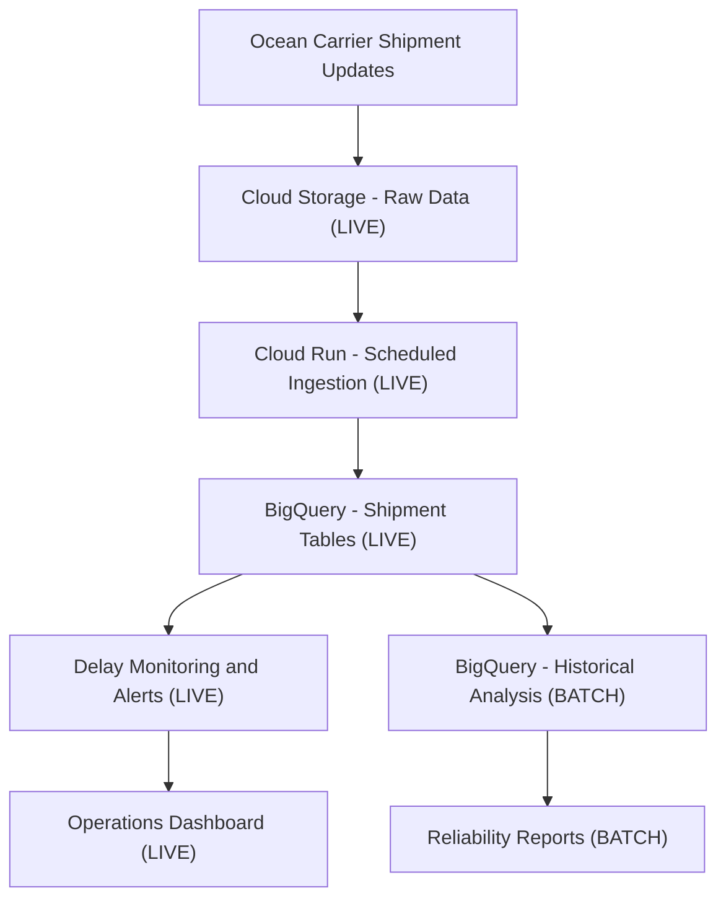

# Alpine Outdoor — Cloud Architecture

**Student:** Yashank Akula  
**Shipper ID:** SHP01  
**Freshness target:** 15 minutes  
**Reliability target:** 55% on each lane  
**Monthly cloud budget:** $20

## Architecture Diagram

## LIVE Components

- Carrier updates: Receive shipment status information.
- Cloud Storage: Store incoming shipment files.
- Cloud Run: Process new updates within 15 minutes.
- BigQuery: Make recent shipment information available.
- Delay monitoring: Identify late shipments.
- Operations dashboard: Display current shipment status.

## BATCH Components

- Historical BigQuery analysis: Calculate average delays and on-time percentages.
- Reliability reports: Generate scheduled performance reports.

## Customer-Specific Design

- Monitor all four Alpine Outdoor ocean shipping lanes.
- Prioritize Ningbo to Hamburg (51.2%) and Busan to Long Beach (52.8%).
- Use lightweight processing and scheduled reporting to control costs.
- Aim to keep total monthly cloud spending within $20.

## Design Notes

This is a proposed architecture, not a deployed system. The LIVE components must collectively meet the 15-minute freshness target. Cloud Run jobs can be scheduled frequently for ingestion, while historical reporting can run less often. Actual cloud costs and freshness performance must be validated.
